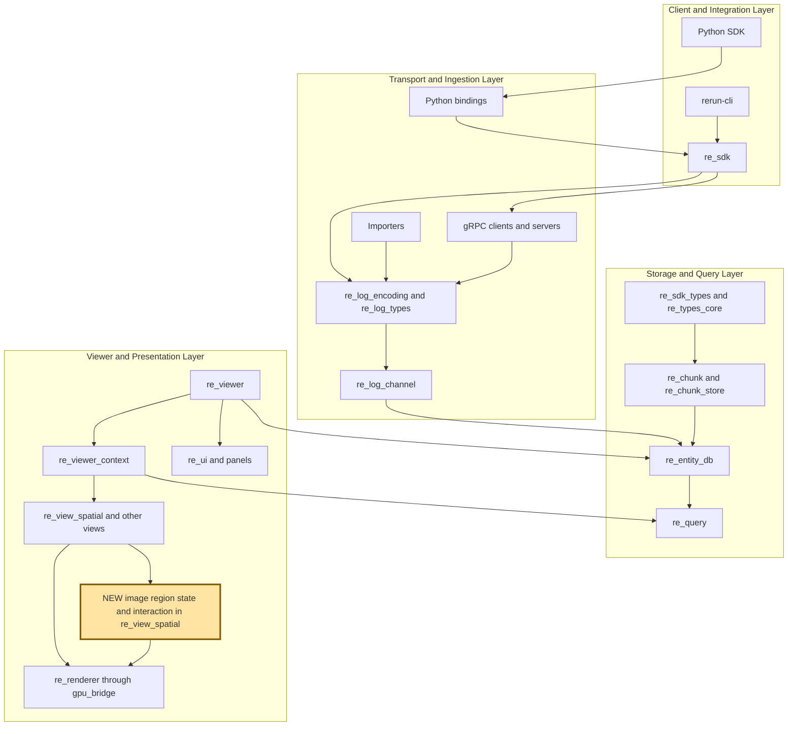

# Image region inspector

## Purpose and acceptance criteria

Donavan requested this feature for the CSCI 360 final project.
No upstream request or maintainer agreement is claimed.
An analyst can inspect a rectangular portion of an image in a Viewer 2D view without changing the recording.

- Enable image region inspection, then drag over an image to select a rectangle.
- Show a magnified crop and its width × height in image pixels.
- Store integer image coordinates, with inclusive minimum and exclusive maximum bounds, clipped to the image.
- Support reverse drags and drags that finish outside the image.
- Keep the outline attached to the same pixels during normal zoom and pan, including translated, scaled, and rotated images in the 2D plane.
- Preserve normal navigation when inspection mode is off; allow clearing a selection and returning to navigation.
- Keep state separate for each view and invalidate the selection when its image disappears or changes resolution.
- Test region geometry at unit level and selection through the real spatial-view UI with logged image data at system level.

This version supports image rectangles in the 2D plane, including decoded color, grayscale, depth, and segmentation images using their existing color mapping.
It excludes frame freezing, tilted 3D image planes, region statistics, crop export, editing, saved blueprint selections, and SDK or recording-format changes.
The public extension is a Viewer interface control and drag interaction.
The work touches existing view state, interaction routing, rendering integration, view help, and documentation; review must consider coordinate transforms, gesture ownership, selection lifetime, and integration tests together.

## Approaches considered before implementation

### Chosen: transient state in the existing spatial view

Use the existing visualizer-produced pickable image rectangles as the image and texture source.
Map the drag through the same scene-to-UI transform as the displayed image, then invert the image rectangle's in-plane affine transform.
Snap the resulting rectangle outward to whole pixels and clamp it to the image resolution.
Reproject the stored image coordinates every frame to paint its outline.
Render the crop by clipping an enlarged instance of the existing colormapped texture through `gpu_bridge::render_image`, as the pixel hover inspector already does.
An explicit inspection mode owns primary drags; leaving it restores pan and normal picking.
This adds no dependency or CPU image copy and retains depth/segmentation color mapping, but requires careful gesture routing and image identity/lifetime checks in the view.

### Rejected: a separate crop viewer backed by a copied CPU image

A separate view could own its own pan/zoom and expose a reusable crop object.
It would simplify isolating crop layout, but would require new view registration, data/query plumbing, CPU crop conversion across image formats, and additional upload or cache invalidation.
That duplicates existing image rendering and expands scope beyond inspecting an image already visible in a 2D view.
The existing hover inspector's GPU clipping path makes transient spatial-view state the smaller coherent solution.

### Rejected: screen-coordinate selection

Keeping the drag endpoints in UI points would make initial drawing simple.
It would fail the requirement that the selected pixels remain fixed across zoom, pan, and image transforms, so it cannot be the selection representation.

## Architectural placement and coupling

The following marks the new responsibility on the logical architecture diagram from the earlier Logical Architecture coursework (local course wiki `Logical-Architecture.md`).
The layer structure and dependency direction are retained; crate paths reflect the current checkout's reorganized directories.

`ui_2d.rs` owns gesture routing and calls the new region UI alongside existing picking and rendering.
`ui.rs` owns per-view transient state and must preserve it when the state is cloned for pan/zoom calculations.
A private region module owns pixel bounds, image coordinate conversion, selection lifetime, outline, and crop presentation.
`lib.rs` registers that module; 2D help documents the interaction.
Integration tests belong in the existing `tests/integration` harness and log images through `TestContext`.
No store, SDK, generated types, or rendering shader changes are planned.
The coupling is to the visualizer's image rectangle contract and the view's shared camera transform, rather than to individual image decoders.

## Design principles

Information Expert keeps image identity, resolution, and texture knowledge with the existing pickable rectangle.
The spatial view acts as the GRASP Controller for the user gesture; region geometry has high cohesion in its own module.
Low Coupling favors the existing GPU bridge over a new crop storage pipeline.
The existing `ViewClass` polymorphism and immediate-mode UI determine integration; an observer or command hierarchy for a single transient gesture would add indirection without a separate lifecycle to manage.

## Security and compatibility

Using the earlier Security Analysis vocabulary, the assets are recording confidentiality and Viewer analysis availability.
This operates after crossing 5 (decoded chunks into the recording store and Viewer); it adds no network entry point, file parser, external importer, export destination, or trust boundary crossing.
Image metadata and pointer coordinates still need finite/nondegenerate checks before inversion and bounded pixel rectangles before preview arithmetic.
Reuse the existing texture, bound preview display size, and avoid allocating in proportion to selected pixel count.
The crop exposes pixels already visible to the analyst in the same process; it does not grant a new principal access.

Existing recordings, SDK callers, and blueprint schemas are unchanged.
The mode defaults off and selection is transient per view, so existing navigation remains the default.
A changed image at the same entity and resolution updates the crop to the current frame; disappearance or resolution change clears stale state.

## Implementation revisions

The first preview fitted every selection into a fixed-size window.
Diff review showed that large selections could therefore be reduced instead of magnified.
The preview now uses five UI points per texel (matching the existing pixel inspector), with scrolling inside a bounded preview.
Review also restricted the affine mapping to z = 0 planes and rejected nonfinite determinants; a parallel image translated in z is affected by the Viewer's perspective projection and cannot use this direct scene-to-image mapping.
The title-bar `ViewClass::extra_title_bar_ui` hook provides the mode toggle without changing the image canvas layout.

Adding a private transient field to the publicly exported `SpatialViewState` means external code constructing that type with a struct literal must use its default constructor instead.
Recording and blueprint compatibility is unaffected, but this Rust source-compatibility limitation requires reviewer attention.

Native Viewer validation exposed interference from ordinary pixel hover inspection while a persistent crop was retained.
The mode toggle now restores pan while the retained region continues to own inspection; clearing the region restores ordinary picking and pixel hover.
The system test includes a second rendered snapshot after pan and zoom, rather than checking only retained coordinate labels.

A later format audit found that `EncodedImage` and `EncodedDepthImage` use the same internal `Video` texture-source variant as playback.
Rejecting that variant would incorrectly reject ordinary PNG/JPEG images.
The inspector therefore accepts every non-placeholder displayed texture; any changing texture follows the current frame, with no added playback or frame-freezing controls.
The system test now exercises both raw RGB data and an asynchronously decoded PNG through the same interaction sequence.

The full-suite review found the new title-bar label appearing in empty views.
The control is now available when a view has displayed images, with one repaint when image availability changes; an enabled mode remains accessible so it can always be disabled after data disappears.
This keeps the tool scoped to image views and preserves the existing empty-view title bar.
