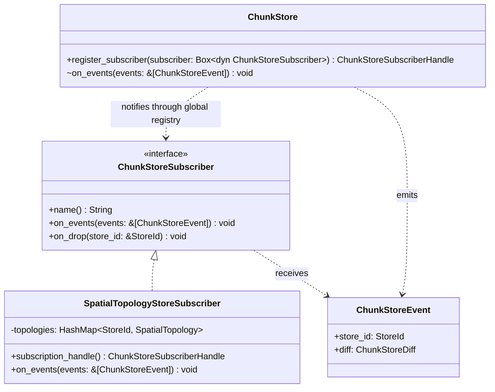
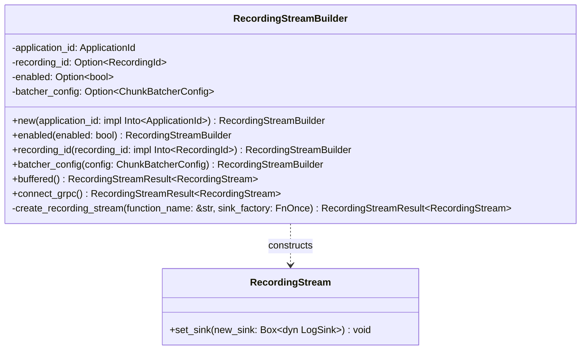
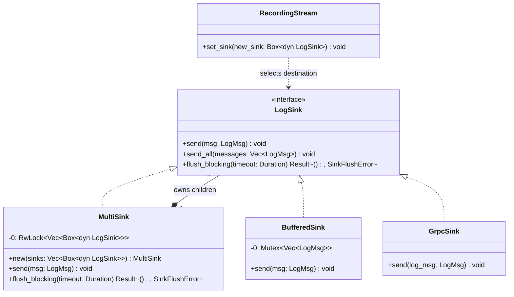

# Design patterns

## Part 1 three existing GoF patterns

This analysis examines how Rerun configures recording streams, combines log destinations, and updates spatial topology after storage changes.
The evidence comes from local source revision `151102da35b14cd3c4c46040c27478c438229aa9`.
Rust structs are shown as UML classes and traits as UML interfaces; only members relevant to each pattern are shown.
Method parameters omit Rust receiver syntax in the diagrams, while code excerpts retain it.
Generic type bounds are abbreviated in the diagrams and retained in source excerpts.

### Pattern 1 observer

**Design pattern used: Observer (behavioral).**
Observer lets an object announce changes to other objects that have registered an interest in them.
In Rerun, the object announcing changes is `ChunkStore`, and one object listening for those changes is `SpatialTopologyStoreSubscriber`.
Spatial topology means the relationships between entities' coordinate spaces, such as how a camera projection connects a 3D space to a 2D image.

**How it works in this code:**

1. `SpatialTopologyStoreSubscriber::subscription_handle()` registers a subscriber with `ChunkStore::register_subscriber()` the first time the handle is requested.
2. Registration puts the subscriber in the shared `SUBSCRIBERS` list.
3. When storage changes are finalized and change notifications are enabled, `ChunkStore` creates events describing the changes and calls `on_events()`.
4. That method walks the subscriber list and calls each subscriber's implementation of `on_events()`.
5. The spatial topology subscriber checks for `SchemaAddition` events, examines the new columns' entity paths and component descriptors, and updates the affected recording's spatial relationships.

For example, when newly discovered columns describe a camera's pinhole projection, the subscriber can update the topology used by spatial views.
The store only needs to know how to notify the `ChunkStoreSubscriber` interface; the subscriber decides how that change affects spatial topology.


**Roles:** `ChunkStore` is the subject, `ChunkStoreSubscriber` is the observer interface, and `SpatialTopologyStoreSubscriber` is a concrete observer.
`ChunkStoreEvent` carries the change notification.
The observer registry is the module-level `SUBSCRIBERS` static in `subscribers.rs`, shared across stores rather than owned by each individual subject.



**Source excerpts:** `crates/store/re_chunk_store/src/subscribers.rs`, registration and notification methods (tracing and comments omitted).

```rust
pub fn register_subscriber(
    subscriber: Box<dyn ChunkStoreSubscriber>,
) -> ChunkStoreSubscriberHandle {
    let mut subscribers = SUBSCRIBERS.write();
    subscribers.push(RwLock::new(subscriber));
    ChunkStoreSubscriberHandle(subscribers.len() as u32 - 1)
}

pub(crate) fn on_events(events: &[ChunkStoreEvent]) {
    let subscribers = SUBSCRIBERS.read();
    for subscriber in subscribers.iter() {
        subscriber.write().on_events(events);
    }
}
```

`crates/views/re_view_spatial/src/spatial_topology.rs` registers the concrete observer:

```rust
pub fn subscription_handle() -> ChunkStoreSubscriberHandle {
    static SUBSCRIPTION: OnceLock<ChunkStoreSubscriberHandle> = OnceLock::new();
    *SUBSCRIPTION.get_or_init(|| ChunkStore::register_subscriber(Box::<Self>::default()))
}
```

**Problem solved here:** spatial views need to discover relationships between entities, including coordinate systems and pinhole projections, when new component columns appear.
`SpatialTopologyStoreSubscriber::on_events` filters `SchemaAddition` events and updates the corresponding store's topology through `on_store_diff`.
Storage can publish changes without depending on the spatial viewer or knowing its topology rules.
Without this notification boundary, the viewer would need repeated discovery scans or storage mutation paths would need direct calls into viewer-specific topology logic.
This is Observer because registered objects receive change notifications through an interface, rather than merely being polled by a client.

**Evidence:** `crates/store/re_chunk_store/src/subscribers.rs:20,121,249`; `crates/store/re_chunk_store/src/store.rs:890` (`finalize_events` notifies when `enable_changelog` is true); `crates/views/re_view_spatial/src/spatial_topology.rs:128,160`.
Subscribers are global and notification order is unspecified; registration before store creation is needed to guarantee that no events are missed.

### Pattern 2 builder

**Design pattern used: Builder (creational).**
Builder separates choosing an object's settings from constructing the finished object.
In Rerun, `RecordingStreamBuilder` collects settings, then constructs a `RecordingStream`, the SDK object used to log recording data.

**How it works in this code:**

1. The caller creates a `RecordingStreamBuilder` with an application ID.
2. Methods such as `enabled()` and `batcher_config()` store configuration choices in the builder.
3. Each configuration method returns the updated builder, so the caller can chain the methods.
4. A terminal method such as `buffered()`, `connect_grpc()`, or `save()` consumes the builder and chooses where logged data will go.
5. The shared `create_recording_stream()` method resolves the configuration and creates the finished stream, including any requested blueprint activation.

For example, `RecordingStreamBuilder::new("rerun_example_camera_demo").enabled(true).buffered()` configures an enabled recording and then creates a stream that initially buffers messages in memory.
The caller reads the configuration choices by name instead of supplying a long list of constructor arguments.
The builder is the object being configured; the returned recording stream is the finished object the caller uses.


**Roles:** `RecordingStreamBuilder` is the concrete builder and `RecordingStream` is its product.
The SDK caller supplies the construction sequence, serving the director role without a separate director class.
This is an idiomatic fluent Rust form of Builder, with one concrete builder and several terminal construction methods rather than a hierarchy of builder classes.



**Source excerpts:** `crates/top/re_sdk/src/recording_stream.rs`, two configuration methods and one terminal construction method.

```rust
pub fn enabled(mut self, enabled: bool) -> Self {
    self.enabled = Some(enabled);
    self
}

pub fn batcher_config(mut self, config: ChunkBatcherConfig) -> Self {
    self.batcher_config = Some(config);
    self
}

pub fn buffered(self) -> RecordingStreamResult<RecordingStream> {
    self.create_recording_stream("buffered", || {
        Ok(Box::new(crate::log_sink::BufferedSink::new()))
    })
}
```

**Problem solved here:** creating a stream involves recording identity, enablement, batching, hooks, properties, optional blueprint activation, and a log destination.
The builder holds those choices until a terminal method consumes it.
`buffered`, `connect_grpc`, and `save` share `create_recording_stream`, which resolves settings, constructs the stream with the chosen sink, and sends the optional blueprint; disabled recording creates a disabled stream without calling the sink factory.
Without the builder, SDK callers would repeatedly assemble the internal constructor arguments or need numerous constructors for combinations of optional settings and destinations.
Returning `Self` from setters is only part of the evidence: the separate configuration object, shared construction process, and finished `RecordingStream` establish the Builder structure.

**Evidence:** `crates/top/re_sdk/src/recording_stream.rs:175,273,360,396,466,567,713,783`.

### Pattern 3 composite

**Design pattern used: Composite (structural).**
Composite lets a group of objects be used through the same interface as one individual object.
In Rerun, a sink is a destination for log messages.
`MultiSink` groups several destinations together and behaves like a single `LogSink` to the recording pipeline.

**How it works in this code:**

1. Individual destinations implement the `LogSink` trait, which defines operations such as `send()` and `flush_blocking()`.
2. `MultiSink` owns a list of objects implementing that same trait.
3. `MultiSink` also implements `LogSink`, so it can be selected as a recording's destination just like an individual sink.
4. When the recording pipeline sends a message to `MultiSink`, its `send()` method clones the message and passes a copy to each child sink.
5. Each child handles its copy in its own way: `BufferedSink` stores it in memory, while `GrpcSink` forwards it to a server.

For example, a `MultiSink` containing a gRPC sink and a file sink sends the same recording data to a live viewer and an on-disk recording.
The recording pipeline makes one call through `LogSink`; the composite handles distributing the message to both destinations.
The common interface is what makes the group usable wherever a single sink is expected.


**Roles:** `LogSink` is the component interface, `MultiSink` is the composite, and `BufferedSink` and `GrpcSink` are concrete leaves.
`RecordingStream` is a client of the component interface; its forwarding thread sends messages through a dynamically selected sink.



**Source excerpts:** `crates/top/re_sdk/src/log_sink.rs`, composite construction and dispatch (attributes omitted).

```rust
pub struct MultiSink(RwLock<Vec<Box<dyn LogSink>>>);

impl MultiSink {
    pub fn new(sinks: Vec<Box<dyn LogSink>>) -> Self {
        Self(RwLock::new(sinks))
    }
}

impl LogSink for MultiSink {
    fn send(&self, msg: LogMsg) {
        for sink in self.0.read().iter() {
            sink.send(msg.clone());
        }
    }
    // Other LogSink methods omitted.
}

impl LogSink for BufferedSink {
    fn send(&self, msg: LogMsg) {
        self.0.lock().push(msg);
    }
    // Other LogSink methods omitted.
}
```

**Problem solved here:** a recording can feed several destinations at once, such as a live viewer over gRPC and an on-disk recording.
`MultiSink` owns child sinks but implements the same interface as a single destination, so the recording pipeline can send once through `LogSink` and let the composite fan out messages.
It also coordinates flushing and shutdown; `flush_blocking` visits all children and retains the most severe error encountered.
Without this object, the forwarding pipeline would need a separate multi-destination path and duplicated dispatch and lifecycle logic.
This is Composite rather than only Strategy: the key relationship is that an aggregate contains objects of the same interface it implements, allowing a collection to be used as one component.
The public tuple conversion API restricts which sinks can be combined through `MultiSinkCompatible`; the UML shows the underlying `MultiSink::new` ownership structure and does not imply that every sink is accepted by that convenience API.

**Evidence:** `crates/top/re_sdk/src/log_sink.rs:39,140,151,308,332,574,629`; `crates/top/re_sdk/src/recording_stream.rs:450,1662,2183`.

## Part 2 a missing strategy for table cell configuration

**Proposed design pattern: Strategy (behavioral).**
The proposed change is in the Python SDK's table blueprint code, specifically `Column`, `TableBlueprint`, and the cell types in `_table_cells.py`.
A table blueprint tells the Viewer how a table should look.
A column's `cell` option selects a presentation such as a link, thumbnail, flag, or embedded recording preview.
The proposed Strategy controls how that presentation's configuration is written into the blueprint; actual visual rendering remains in the Viewer.
This proposal has not been implemented.

### The concrete problem today

`PreviewCell` already owns its embedded `View` objects, but the callers implement the behavior associated with those objects.
`Column._log_to_stream()` checks whether its cell is specifically a `PreviewCell` and builds the preview configuration from `self.cell.views`.
Separately, `TableBlueprint._log_to_stream()` checks every column for `PreviewCell` and reaches into `column.cell.views` to discover the views it must write to the recording stream.

The same cell-specific knowledge is spread across two callers: both know that previews contain views, while one also knows the preview archetype and the representation of view references.
The cell itself mostly stores data and a kind identifier.
That makes the generic column and blueprint classes responsible for part of a concrete cell type's serialization behavior.
This coupling exists today, even without adding any new cell types.

For example, configuring a preview column with a `Spatial2DView` requires two coordinated steps: write the view definition and write its path into the preview column's configuration.
Those steps are currently implemented in different callers rather than exposed by the object that owns the view.
A developer maintaining preview serialization must understand and update that distributed behavior.
A cell needing similar resources cannot express that behavior through the current `_Cell` interface, which only provides `_kind`.

**Existing preview handling in `Column._log_to_stream()`** (`table.py:132`):

```python
if isinstance(self.cell, PreviewCell):
    stream.log(path, TableColumnPreview(views=[view.blueprint_path() for view in self.cell.views]))
```

**Existing preview discovery in `TableBlueprint._log_to_stream()`** (`table.py`, excerpt):

```python
views: dict[str, View] = {
    view.blueprint_path(): view
    for columns in layouts
    for column in columns
    if isinstance(column.cell, PreviewCell)
    for view in column.cell.views
}

for view in views.values():
    view._log_to_stream(stream)
```

There is an important existing guarantee here: if table and card layouts share a preview view, the dictionary deduplicates it by blueprint path so it is logged once.
The refactoring must preserve that behavior and the order in which view definitions and column references are logged.

### The proposed design

Turn the existing `_Cell` base into a behavioral Strategy interface for cell configuration.
Use the existing concrete classes as implementations rather than introduce a parallel hierarchy.
The cell objects already identify the selected presentation; the missing piece is delegating their configuration behavior to them.

| Strategy role | Type | Responsibility after the change |
| --- | --- | --- |
| Context | `Column` | Write common column properties, then delegate cell-specific configuration to its selected cell. |
| Strategy interface | `_Cell` | Expose cell-specific configuration logging and any referenced view definitions. |
| Concrete strategy | `PreviewCell` | Supply its views and write `TableColumnPreview` with their blueprint paths. |
| Other concrete strategies | `LinkCell`, `ThumbnailCell`, `FlagCell`, `EntryKindCell` | Use the default behavior of no extra configuration and no referenced views. |
| Coordinator | `TableBlueprint` | Gather view dependencies through the shared interface, deduplicate them, and log views before layouts and columns. |

Two private methods are proposed, with final signatures to be settled in Part 3:

- `_blueprint_views()` returns the views required by a cell; the base implementation returns an empty tuple and `PreviewCell` returns its `views`.
- `_log_to_stream(stream, path)` writes additional cell-specific configuration; the base implementation does nothing and `PreviewCell` writes the preview archetype.

`Column` would keep ownership of common properties such as the display name, visibility, editable setting, and cell kind.
It would ask the selected cell to write any additional configuration after those common properties.
`TableBlueprint` would gather views by calling the shared method on each configured cell, then retain its existing deduplication and logging order.
Neither caller would need an `isinstance(..., PreviewCell)` branch for serialization.

### How it would work for a real preview column

Suppose a caller creates `Column("recording/link", cell=PreviewCell(view))` and uses that column in both table and card layouts.

1. `PreviewCell` stores the `view`, as it already does today.
2. `TableBlueprint` asks each configured cell for its view dependencies through `_blueprint_views()`.
3. `PreviewCell` supplies the view; other cell implementations supply no views.
4. `TableBlueprint` deduplicates the returned views by blueprint path and writes the shared view once.
5. Each layout logs its column configuration through `Column`.
6. `Column` writes its common properties and delegates extra configuration to the cell's `_log_to_stream()` method.
7. `PreviewCell` writes its own view references at that layout's column path.

The resulting blueprint should contain exactly the same view definitions and column components as before.
The improvement is that preview-specific serialization lives in `PreviewCell`, and the callers operate through a shared interface.
These are interchangeable serialization behaviors, which is why the proposed pattern is Strategy.
The existing classes provide a starting point for the pattern, but their serialization behavior is currently implemented outside that hierarchy.

### Connection to GRASP

**Current responsibility problem: Information Expert and Low Coupling.**
`PreviewCell` has the information about its views, but `Column` and `TableBlueprint` interpret that information and implement preview-specific serialization.
Those callers depend on a concrete cell class and its data representation.

**Principles the change applies: Information Expert, Low Coupling, and Polymorphism.**
Move the interpretation and serialization of preview configuration to the cell that owns it.
Give the callers a common interface and let the selected cell implementation determine the behavior.
`TableBlueprint` should continue coordinating and deduplicating view definitions because it has information about all layouts; individual cells do not.
This keeps cross-layout coordination separate from cell-specific configuration and improves cohesion in both places.

### Scope and validation for part 3

The proposed change is limited to handwritten Python files `rerun_py/rerun_sdk/rerun/blueprint/_table_cells.py` and `rerun_py/rerun_sdk/rerun/blueprint/table.py`, plus relevant tests.
It would preserve public constructors, existing accepted values, generated archetypes, and the serialized blueprint format.
The `FlagCell` checks enforcing editing and card-layout restrictions are separate validation rules and are outside this serialization refactoring.
The change would not introduce new renderers or promise support for arbitrary user-defined renderer types.

Existing tests in `rerun_py/tests/unit/test_table_blueprint.py` verify actual saved blueprint components for preview and flag columns across table and card layouts.
`test_table_blueprint_logs_shared_preview_once` verifies the shared view is logged once.
Part 3 would run those tests, check ordinary cells and absent cells still require no extra configuration, and verify that delegation uses the common interface rather than a hard-coded preview type check.
Required Python formatting and relevant checks would follow.

**Why this is stronger than the compression proposal:** the responsibility split affects an existing feature and can be demonstrated with a current preview-column example.
The refactoring would relocate real behavior from two callers into the existing cell hierarchy, rather than primarily prepare for a hypothetical new algorithm.
The current code is short and functional, so this remains a modest design improvement rather than a fix for an observed runtime failure.

**Evidence:** `rerun_py/rerun_sdk/rerun/blueprint/_table_cells.py` (`_Cell` and `PreviewCell`); `rerun_py/rerun_sdk/rerun/blueprint/table.py` (`Column._log_to_stream` and `TableBlueprint._log_to_stream`); `rerun_py/tests/unit/test_table_blueprint.py` (`test_table_blueprint_logs_layouts_columns_and_preview_views` and `test_table_blueprint_logs_shared_preview_once`).

## Part 3 implement the table cell strategy

The cell hierarchy now owns cell-specific blueprint behavior.
`_Cell` defines `_blueprint_views()` and `_log_to_stream(stream, path)`.
Ordinary cell types inherit empty view dependencies and no additional configuration, while `PreviewCell` overrides both operations.
The public constructors and cell kinds are unchanged.

### Before

`Column` constructed preview settings after checking the concrete cell type:

```python
if isinstance(self.cell, PreviewCell):
    stream.log(path, TableColumnPreview(views=[view.blueprint_path() for view in self.cell.views]))
```

`TableBlueprint` separately checked for `PreviewCell` before accessing its `views` to collect dependencies.

### After

The selected cell controls its extra configuration through the shared interface:

```python
# Column._log_to_stream
if self.cell is not None:
    self.cell._log_to_stream(stream, path)


# PreviewCell
def _blueprint_views(self) -> tuple[View, ...]:
    return self.views


def _log_to_stream(self, stream: RecordingStream, path: str) -> None:
    stream.log(path, TableColumnPreview(views=[view.blueprint_path() for view in self.views]))
```

`TableBlueprint` gathers dependencies by calling `column.cell._blueprint_views()` for each configured cell.
It retains its dictionary keyed by blueprint path so shared views are logged once, before column references.
`Column` retains common column properties and delegates only the cell-specific configuration.
The editing and card-layout restrictions on `FlagCell` remain validation responsibilities and are unchanged.

### What is easier to change

Preview serialization and the interpretation of preview view dependencies now live with `PreviewCell` rather than in two consumers.
A cell implementation can supply configuration and view dependencies through the same interface without adding a concrete-type branch to either consumer.
This is the Strategy relationship: the context delegates to the selected cell's implementation of shared operations.
It applies Information Expert to preview behavior and lowers the consumers' coupling to the concrete preview type.

### Validation

The matching native Python SDK built successfully with `pixi run py-build`.
All 16 tests passed with `.venv/bin/python -m pytest -q rerun_py/tests/unit/test_table_blueprint.py`.
The focused Python formatting and Ruff checks pass, and `pixi run fast-lint` passed, including Python type checking and the generated-code consistency check.
The added regression test uses a non-preview cell subclass with view dependencies and verifies that both layouts delegate to it while its shared view is logged once.
Existing tests verify the saved components for preview and flag columns and shared-preview deduplication.

Part 4 below documents the separate datatype-formatting refactoring associated with issue #11071.

## Part 4 apply information expert to datatype naming

`DataTypeUi` previously maintained a primitive-name lookup table, and the documentation generator maintained another, even though Arrow's `DataType` and the generator's `AtomicDataType` already provide names through `Display`.
I removed those lookups and delegated naming to the datatype objects, applying GRASP Information Expert while leaving UI hierarchy and Markdown layout with their existing consumers.
This reduces duplicated naming responsibility and aligns non-nested UI labels with table formatting, including preserving the distinction between `Utf8` and `LargeUtf8` and between `Binary` and `LargeBinary`.

### Relationship to issue 11071

This is a focused contribution toward [issue #11071](https://github.com/rerun-io/rerun/issues/11071), which identifies overlapping datatype-formatting implementations.
It removes the duplicated primitive mappings in `DataTypeUi` and `atomic_datatype_docs` without creating a new abstraction or adding dependencies.
The UI and table formatter now both obtain non-nested names from Arrow's `Display`; documentation obtains atomic names from its own datatype model's derived `Display` implementation.
The generator uses a separate logical datatype model, so it continues to describe logical strings as `Utf8` rather than change its schema descriptions to physical storage types.

The observable UI change is that large-offset string and binary types are labeled `LargeUtf8` and `LargeBinary`, rather than being shortened to `Utf8` and `Binary`.
Other previously mapped primitive labels are unchanged, and parameterized types retain Arrow's existing names.
Full unification of nested-type presentation and the issue's additional syntax-highlighting request remain outside this refactoring; this commit does not claim to close the entire issue.

### Validation

Rust formatting and Clippy passed for both affected crates.
All 35 affected-crate tests passed with `cargo nextest run -p re_arrow_ui -p re_types_builder --all-features --no-fail-fast`, including the UI image tests.
A regression test compares non-nested UI labels with the actual table formatter for primitives, large-offset variants, and a timestamp.
The `LargeBinary` reference image was updated after visually confirming that the only change is its corrected datatype label.
Final fast lint checks passed, including generated-code consistency checking, confirming that replacing the documentation lookup does not change generated output.

Local commit message: `A8-GRASP: Refactor DataTypeUi to apply Information Expert`.

## Review status

Parts 1 and 2 are drafted.
Part 3 is implemented and its focused tests pass.
Local implementation commit message: `A8: Apply Strategy to Column`.
Part 4 is implemented and its affected-crate tests pass.
Parts 5 and 6 have not been started.

## AI use log

| Date | Tool | How AI Was Used | Verification Performed |
| --- | --- | --- | --- |
| 2026-10-14 | OpenAI Codex | Read assignment 09, inspected the local Rerun source, and drafted Part 1 with Observer, Builder, and Composite role mappings, Mermaid class diagrams, code excerpts, and project-specific explanations. Created the local assignment branch. | Checked named structs, traits, fields, and methods against the local source. Traced subscriber registration and topology updates, builder terminal methods and shared construction, and composite message dispatch and flushing. Confirmed the documentation copies match and no implementation code was changed. Mermaid rendering has not yet been visually verified. Human review is pending. |
| 2026-10-14 | OpenAI Codex | Revised Part 1 to explicitly name each GoF pattern and category, define it in plain language, and explain its execution sequence with a Rerun example. | Kept the explanations aligned with the previously inspected registration, construction, and sink dispatch code. No implementation changes. |
| 2026-10-14 | OpenAI Codex | Inspected compression selection in Arrow payload conversion and drafted Part 2 proposing Strategy, with the current maintenance problem, proposed roles, GRASP rationale, implementation scope, and validation plan. | Read both compression branches, existing malformed-payload tests, and the related protobuf conversion path. Distinguished proposed types from existing code and recorded the limits of the proposal. No implementation changes. |
| 2026-10-14 | OpenAI Codex | Expanded Part 2 with a hypothetical third-algorithm maintenance example, proposed interface and byte ownership, encoding and decoding flows, and concrete benefits and costs. | Preserved the distinction between existing source and proposed pseudocode, the existing decompression limits, and the protocol compatibility requirements. No implementation changes. |
| 2026-10-14 | OpenAI Codex | Replaced the compression proposal with a Strategy for table cell configuration after reviewing existing preview-specific behavior in two callers. | Inspected the cell hierarchy, both serialization paths, and saved-blueprint and shared-preview tests. Recorded preservation of deduplication, logging order, public APIs, and separate validation rules. No implementation changes. |
| 2026-10-14 | OpenAI Codex | Implemented the approved table-cell Strategy and added a regression test for generic cell delegation and shared-view deduplication. | Focused Python formatting and Ruff checks passed. The matching SDK build succeeded, all 16 table-blueprint tests passed, and fast-lint passed including Python type checking and codegen consistency. No pushes or external posts. |
| 2026-10-14 | OpenAI Codex | Applied GRASP Information Expert to datatype naming for Part 4, removing duplicate UI and documentation primitive mappings and adding a cross-consumer naming regression test. | Rust formatting, Clippy, and final fast lint checks passed; all 35 affected-crate tests passed. Fetched missing Git LFS snapshot references, visually reviewed the intended LargeBinary label correction, and updated its one reference image. The documented scope is a focused contribution toward #11071, not the full syntax-highlighting request. |
